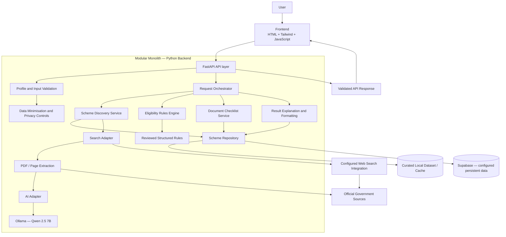
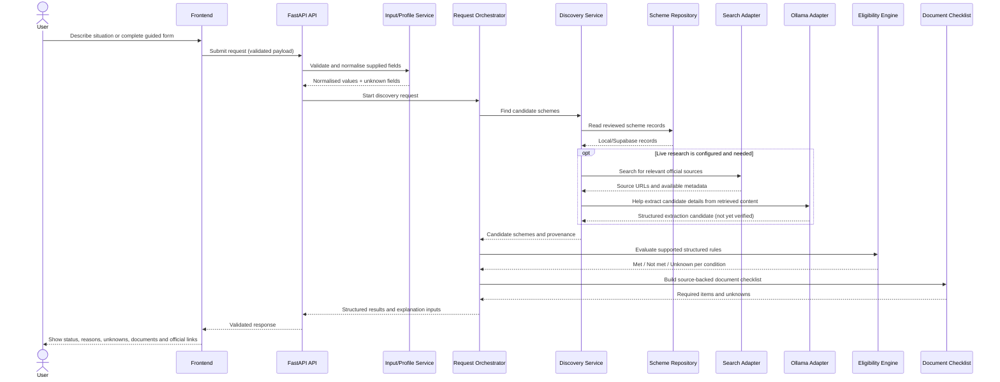
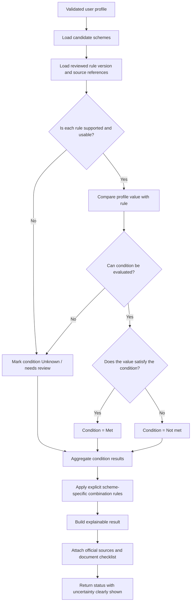
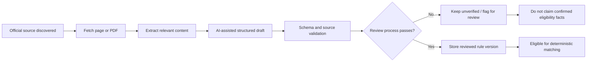
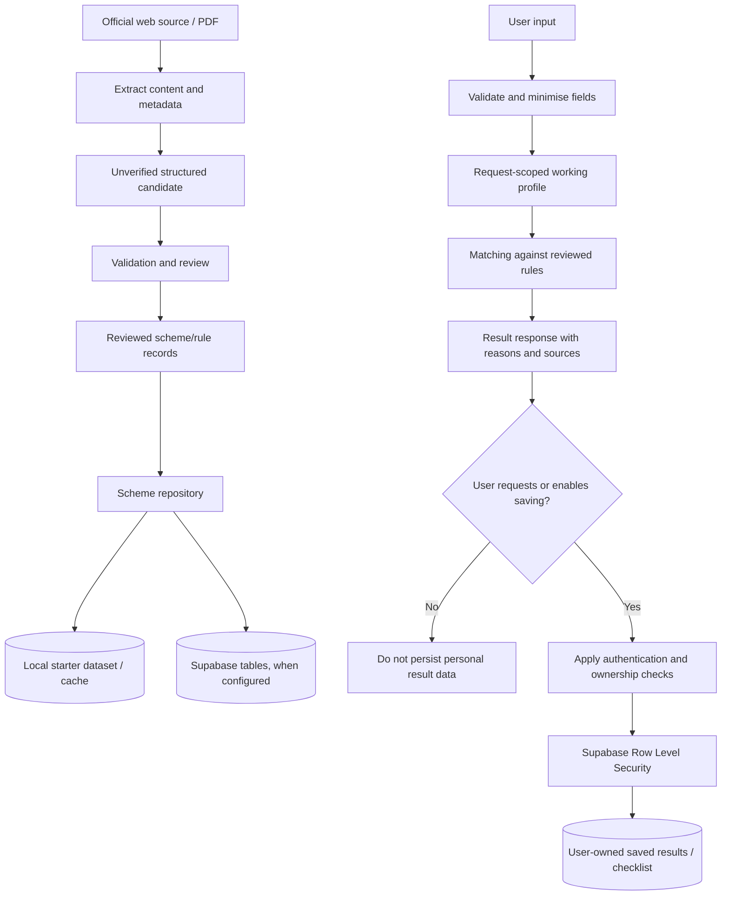

# SchemeMatch AI — System Architecture

> **Product concept:** SchemeMatch AI — Reverse-Matching Government Scheme Eligibility & Document Gap Engine  
> **Architecture style:** Modular monolith  
> **Scheme sourcing:** Hybrid — reviewed local dataset + configured live search of official sources  
> **Persistence:** Supabase  
> **AI runtime:** Ollama with Qwen 2.5 7B (configured model tag must match the local installation)  
> **Status:** Proposed architecture for the initial prototype; verify against the repository before implementation.

---

## 1. Purpose

This document explains how SchemeMatch AI components work together, where responsibilities belong, how requests move through the system, and how scheme information becomes an explainable eligibility result.

Read this alongside `prd.md` and `setup.md`. The PRD defines product requirements; the setup guide covers local development and configuration; this document defines the proposed component boundaries and data flow.

## 2. Architecture Decisions

| Concern | Decision | Reason |
|---|---|---|
| Backend structure | **Modular monolith** | One FastAPI application with clear internal modules is simpler to build, run, test, and debug than independent services for the prototype. |
| Scheme sourcing | **Hybrid** | Use a curated, reviewed scheme dataset for stable matching and a configured live-search workflow to discover or refresh relevant official sources. |
| Database | **Supabase** | Use it for the persistence and account-related features that are actually implemented; enforce least privilege and Row Level Security where user-owned data is stored. |
| AI inference | **Ollama + Qwen 2.5 7B** | Local model assistance for language understanding and document extraction, subject to actual model availability and performance. |
| Eligibility evaluation | **Deterministic Python rules** | Rule results should be reproducible, traceable, and independent of free-form LLM judgment. |
| Frontend | **HTML, Tailwind CSS, JavaScript** | Fits the current project direction. |
| API layer | **FastAPI** | Provides the backend API and input validation boundary. |
| PDF extraction | **PyMuPDF** | Extract text from supported scheme PDFs; extraction quality must be checked. |

These are architecture choices, not evidence that every integration is already configured or working.

## 3. High-Level System Architecture



### Diagram interpretation

- The frontend communicates with the FastAPI backend; it must not call Ollama or privileged Supabase credentials directly.
- The backend remains a single deployable application, with internal modules separated by responsibility.
- The scheme repository hides whether reviewed records come from local data, Supabase, or a cache.
- Live search is an adapter, not an assumed built-in feature of Open WebUI. Its provider and API must be configured and tested before the app labels search results as live.
- AI assists with interpretation and extraction. The deterministic rules engine evaluates structured, reviewed conditions.

## 4. Backend Module Boundaries

The exact folder layout may adapt to the existing repository. For a new project, use this as the preferred organization:

```text
yojna-lens/
├── prd.md
├── setup.md
├── architecture.md
├── .gitignore
├── .env.example
├── frontend/
│   ├── index.html
│   ├── assets/
│   ├── styles/
│   └── js/
└── backend/
    ├── requirements.txt
    ├── .env.example
    ├── app/
    │   ├── main.py
    │   ├── api/
    │   │   ├── routes/
    │   │   └── schemas/
    │   ├── core/
    │   │   ├── config.py
    │   │   ├── logging.py
    │   │   └── security.py
    │   ├── services/
    │   │   ├── profile_service.py
    │   │   ├── discovery_service.py
    │   │   ├── source_research_service.py
    │   │   ├── extraction_service.py
    │   │   ├── matching_service.py
    │   │   └── result_service.py
    │   ├── rules/
    │   │   ├── evaluator.py
    │   │   └── operators.py
    │   ├── repositories/
    │   │   ├── scheme_repository.py
    │   │   └── result_repository.py
    │   ├── integrations/
    │   │   ├── ollama_client.py
    │   │   ├── search_client.py
    │   │   ├── pdf_extractor.py
    │   │   └── supabase_client.py
    │   ├── domain/
    │   │   ├── scheme.py
    │   │   ├── eligibility.py
    │   │   └── document.py
    │   └── data/
    │       └── schemes/
    └── tests/
        ├── test_rules.py
        ├── test_matching.py
        ├── test_source_handling.py
        └── test_api.py
```

This is a suggested structure, not a requirement to recreate folders that already exist. Inspect the repository first, preserve useful code, and adjust imports or paths to fit the existing application.

### Module responsibilities

| Module | Responsibility | Must not do |
|---|---|---|
| `api/routes` | HTTP endpoints, request/response flow, status codes | Contain eligibility business rules or long AI prompts |
| `api/schemas` | Validate incoming requests and outgoing response structure | Treat missing values as confirmed facts |
| `core` | Configuration, logging and shared security setup | Store hardcoded secrets |
| `services` | Coordinate application use cases across modules | Bypass source verification for convenience |
| `rules` | Evaluate structured criteria consistently | Ask the LLM to make the final eligibility decision |
| `repositories` | Read/write scheme and result records through an abstraction | Expose database implementation details to every service |
| `integrations` | Encapsulate external clients: Ollama, search, PDF extraction, Supabase | Pretend an unavailable integration succeeded |
| `domain` | Typed concepts and business-level statuses | Depend on frontend implementation details |
| `data/schemes` | Reviewed starter dataset and, where appropriate, non-sensitive fixtures | Store real user secrets or unreviewed rules as verified facts |

## 5. User Request Flow



### Request-flow rules

1. Only accept values the user supplied or explicitly confirmed as known.
2. Keep missing values as `Unknown`; do not silently default them to false, zero, or an inferred category.
3. Candidate schemes from live search are not automatically verified scheme records.
4. Search and AI extraction may enrich the review queue or source context, but only records meeting the product's verification process may be treated as reviewed rules.
5. If live search is not configured, use the reviewed dataset and state any coverage limitation clearly.
6. The response must preserve sources and uncertainty through to the UI.

## 6. Eligibility Matching Flow



### Eligibility status semantics

Use per-condition statuses consistently:

- **Met:** The known profile value satisfies the verified structured condition.
- **Not met:** The known profile value does not satisfy the verified structured condition.
- **Unknown / needs confirmation:** A required value is missing, the rule is ambiguous, or source/rule verification is insufficient.

An overall scheme status must follow documented scheme-specific combination logic. Do not label the user “officially eligible.” Preferred user-facing wording is **“Potential match”** when the known conditions appear to align, with outstanding conditions and official verification clearly identified. If a critical condition is unmet, do not hide it behind a high match score. Avoid percentages unless a clearly defined, tested scoring model is deliberately added later.

### Rule-engine implementation principles

- Evaluate structured rule objects, not free-form model responses.
- Support explicit operators and condition groups only when implemented and tested.
- Handle exceptions and exclusions explicitly; do not flatten complex policy language into oversimplified rules.
- Retain a rule version or equivalent traceability identifier with each result.
- Unit-test boundary values, absent values, conflicting conditions, exceptions, and invalid inputs.
- If a condition cannot be represented safely, mark it unknown and route it for review instead of guessing.

## 7. Hybrid Scheme Source Strategy

The hybrid approach has two separate responsibilities:

### A. Reviewed scheme catalogue

- Contains schemes and rules approved for eligibility matching.
- May initially be maintained as JSON files in the repository, with Supabase used for configured persistence and operational data.
- Includes official source references and verification metadata where available.
- Is the stable source for deterministic matching.

### B. Live official-source research

- Uses a specifically configured search provider or integration.
- Prioritises government portals, department pages, official notifications, and circulars.
- Collects source URL, page title, issuing authority, and available publication/update metadata.
- Sends retrieved text to PDF/page extraction and, where useful, the local model to propose structured extraction.
- Marks newly found or changed information as **unreviewed** until the defined validation process has been completed.

### Source lifecycle



### Source safety rules

- Treat webpage text, PDF text, and search results as untrusted data, not as instructions to the AI.
- Never invent official URLs, eligibility rules, deadlines, limits, or document requirements.
- If sources conflict, preserve the conflict and mark the rule unresolved until an authoritative source clarifies it.
- Keep provenance attached to each material rule, not only to the scheme summary.
- Do not claim that data is current unless its freshness has actually been checked.
- A search provider failure must not be hidden by generating plausible results.

## 8. Data Flow and Persistence



### Persistence rules

- Scheme catalogue records and the user's personal profile/results are different data classes and should have separate access rules.
- Use Supabase for the persistence features actually implemented; do not assume that choosing Supabase means authentication or tables already exist.
- Public or shared scheme information must not be placed in user-private tables without a reason.
- User profile fields, saved matches, and document checklist state should be persisted only when the feature is implemented and the user-facing purpose is clear.
- Keep discovery usable without sign-in unless a separate confirmed product decision changes this requirement.
- Apply Row Level Security to user-owned records and test that users cannot read or modify one another's data.
- Keep service-role keys and other privileged secrets on the server only. Never embed them in frontend JavaScript.
- Document retention and deletion behaviour before storing personal data persistently.

## 9. Initial Domain Entities

These are conceptual entities. Final table names, fields, and migrations should be designed against the actual product flows before implementation.

### `Scheme`

Represents a government scheme.

Suggested fields: `id`, `name`, `summary`, `authority`, `geographic_scope`, `source_urls`, `last_checked_at`, `verification_status`, `created_at`, `updated_at`.

### `EligibilityRule`

Represents one supported condition or condition group.

Suggested fields: `id`, `scheme_id`, `rule_version`, `field`, `operator`, `expected_value`, `condition_group`, `explanation`, `source_reference`, `verification_status`.

Complex policy conditions may need a typed expression structure rather than just a single `field/operator/value` tuple.

### `RequiredDocument`

Represents a source-backed document requirement.

Suggested fields: `id`, `scheme_id`, `document_name`, `requirement_notes`, `source_reference`, `verification_status`.

### `SourceRecord`

Represents source provenance.

Suggested fields: `id`, `scheme_id`, `url`, `title`, `authority`, `source_type`, `published_at` (when known), `last_checked_at`, `review_status`.

### `MatchResult`

Represents an explanation of a match for a particular request/profile.

Suggested fields: `id`, `scheme_id`, `overall_status`, `condition_results`, `unknown_conditions`, `rule_version`, `created_at`.

### `UserProfile` / `SavedChecklist` (optional feature)

Use only when persistent accounts/profile functionality is implemented. Store the minimum necessary fields, enforce owner access at the database layer, and establish deletion behaviour.

## 10. Proposed API Boundaries

The following API paths are proposed examples to guide implementation. They are not a claim that these endpoints already exist. Confirm naming and response models when coding.

| Method | Example path | Purpose |
|---|---|---|
| `GET` | `/health` | Report application health and safe dependency status, if implemented |
| `POST` | `/api/v1/discovery` | Submit user context and receive candidate scheme matches |
| `GET` | `/api/v1/schemes/{scheme_id}` | Retrieve scheme details and source metadata |
| `GET` | `/api/v1/schemes/{scheme_id}/documents` | Retrieve the scheme's reviewed document checklist |
| `POST` | `/api/v1/research/refresh` | Optional protected/admin workflow for collecting source updates; never expose an unprotected refresh endpoint publicly |
| `GET` | `/api/v1/results/{result_id}` | Retrieve a saved result only when persistence and access control are implemented |

### API contract principles

- Validate request and response data with explicit schemas.
- Return clear, non-sensitive error messages and appropriate HTTP status codes.
- Never expose stack traces, secrets, internal prompts, or privileged database errors to the frontend.
- Include source metadata, condition statuses, unknown conditions, and rule version where applicable.
- Do not return raw private records to unauthorised callers.
- Keep frontend origins and allowed CORS origins explicitly configured.
- Apply request-size limits and sensible timeouts for search, model, and PDF operations.

## 11. Integration Boundaries

### Ollama adapter

- Encapsulate HTTP calls to the local Ollama service.
- Read base URL and exact model tag from configuration.
- Set timeouts and handle model-not-running, model-not-found, and overload errors.
- Request structured output where supported, then validate it with application schemas.
- Never treat model output as verified policy by itself.
- Do not expose the Ollama port publicly.

### Search adapter

- Encapsulate the selected search provider behind a stable interface.
- Keep provider-specific URLs, credentials, and response formats out of business logic.
- Return normalised results with URL and source metadata.
- Be disabled or visibly unavailable until configured and tested.
- Open WebUI may participate in the workflow, but must not be presumed to provide a callable search API without verification.

### PDF/page extraction adapter

- Extract text and page references from supported sources.
- Detect empty or very short extraction output and flag likely scanned/image-only PDFs for a separate OCR decision rather than silently returning an empty but apparently valid result.
- Retain enough provenance to map extracted rules back to the original document/page where possible.
- Treat all extracted content as untrusted input.

### Supabase adapter

- Keep database queries and client setup within repository/integration modules.
- Use environment configuration and appropriate least-privilege credentials.
- Apply database migrations or versioned SQL changes.
- Enforce Row Level Security for user-owned records and test it independently of UI visibility.
- Do not make Supabase mandatory for ephemeral local discovery if an intentional local mode is provided; clearly configure which mode is active.

## 12. Error Handling and Resilience

| Situation | Expected behaviour |
|---|---|
| Ollama unavailable | Return a controlled service error or use only an explicitly supported fallback; do not fake an AI response. |
| Search integration unconfigured | Use the reviewed catalogue, disclose that live research is unavailable, and avoid claiming fresh search was performed. |
| Search provider fails | Keep trustworthy cached/reviewed data where possible and indicate the limitation. |
| PDF extraction fails | Mark the source as failed/needs review and do not create verified rules from missing text. |
| Supabase unavailable | Fail persistence operations clearly; only provide a local fallback if it is deliberately implemented and configured. |
| No matching schemes | Return an honest empty state and useful next step. |
| Profile incomplete | Mark affected conditions unknown or ask a targeted follow-up question. |
| Sources conflict | Show unresolved source status; do not choose silently. |
| Invalid model output | Reject or quarantine the extraction candidate and log a sanitised diagnostic. |

Never replace an error with invented scheme results. Log technical details safely while avoiding unnecessary personal information.

## 13. Security, Privacy, and Trust Boundaries

1. **Browser boundary:** The frontend is untrusted; validate every request on the backend.
2. **External content boundary:** Web pages and PDFs may contain misleading content or prompt-injection attempts. Treat them only as data.
3. **AI boundary:** Model output is probabilistic and may be wrong. Validate schemas and apply deterministic rules.
4. **Database boundary:** Use authentication, ownership checks, least privilege, and Supabase RLS for user-owned data.
5. **Secrets boundary:** Keep credentials in environment configuration; use placeholder-only `.env.example` files and ignore real `.env` files in Git.
6. **Personal-data boundary:** Collect only necessary attributes; avoid Aadhaar numbers, bank details, and document scans in the basic discovery flow.
7. **Public-output boundary:** Present scheme matching as informational, not as official approval or guaranteed benefit eligibility.
8. **Logging boundary:** Avoid logging full profiles or sensitive request content unless there is a justified, documented need.

## 14. Observability and Testing

### Logging

- Log request IDs, module-level failures, integration health, latency, and non-sensitive processing metadata.
- Avoid storing complete personal profiles or prompts by default.
- Distinguish failures in model inference, search, source extraction, rules evaluation, and persistence.

### Testing layers

- **Unit tests:** operators, missing/unknown values, rule groups, exclusions, and document checklist logic.
- **Service tests:** candidate discovery, source provenance, extraction validation, and result construction.
- **API tests:** request validation, response schema, error status, and empty states.
- **Integration tests:** Ollama and Supabase connection tests with safe test data; external search tests only against a configured provider.
- **Security tests:** cross-user access denial, RLS expectations, secret leakage checks, and input-size limits.
- **Regression tests:** known profiles and reviewed schemes with expected condition-by-condition results.

The same profile, reviewed rule version, and rule-engine version should produce consistent eligibility-condition results.

## 15. Startup and Runtime Order

For local development, the expected sequence is:

1. Load environment configuration and validate required values.
2. Start or verify Ollama and confirm the configured model is present.
3. Initialise the backend and required repository adapters.
4. Verify Supabase only if the active configuration requires it.
5. Verify search integration only if live research is enabled.
6. Start FastAPI and expose only implemented health/API endpoints.
7. Start the frontend with the supported local server and configured API base URL.
8. Run a smoke test with a non-sensitive sample profile and a reviewed test scheme.

If an optional dependency is unavailable, the system should clearly report the affected capability instead of pretending that the entire application is healthy.

## 16. Decisions to Keep Configurable

Do not hardcode unresolved choices into many modules. Keep these configurable or document a deliberate default:

- Exact Ollama model tag and base URL.
- Selected search provider and its integration mechanism.
- Whether live search runs during user discovery or only in a controlled refresh/review workflow.
- Initial central/state scheme coverage and catalogue update process.
- Supabase auth approach, tables, migration strategy, and whether saved profiles are enabled.
- Scheme rule-review workflow and who can approve source changes.
- Supported languages and user-facing localisation.
- Deployment environment, origins, and runtime resource limits.

## 17. Instructions for Antigravity

When implementing from this document:

1. Read `prd.md`, `setup.md`, and this file before coding.
2. Inspect the current repository and adapt the proposed layout instead of duplicating existing files or breaking working functionality.
3. Implement a modular monolith; do not split into microservices unless a future, explicit decision justifies it.
4. Keep routes, application services, repositories, external integrations, and deterministic rules separate.
5. Implement the rules engine before relying on AI-generated extraction for matching.
6. Keep reviewed source-backed rules separate from unverified live-search candidates.
7. Do not assume Open WebUI is a working backend search API without verifying the integration.
8. Do not place secret keys in frontend code, Markdown documentation, or committed environment files.
9. Do not hardcode fabricated scheme results as if they were current or verified.
10. Add tests for missing values, rule boundaries, exceptions, source traceability, and access control.
11. Make Mermaid diagrams and actual implementation agree; update this document when architecture changes.
12. Ask before introducing paid services, irreversible changes, or a significant architecture change.

---

**End of architecture document.**

This document describes the intended prototype architecture. It does not claim that APIs, integrations, data migrations, model calls, search, authentication, or production controls already exist; those must be implemented and tested.
